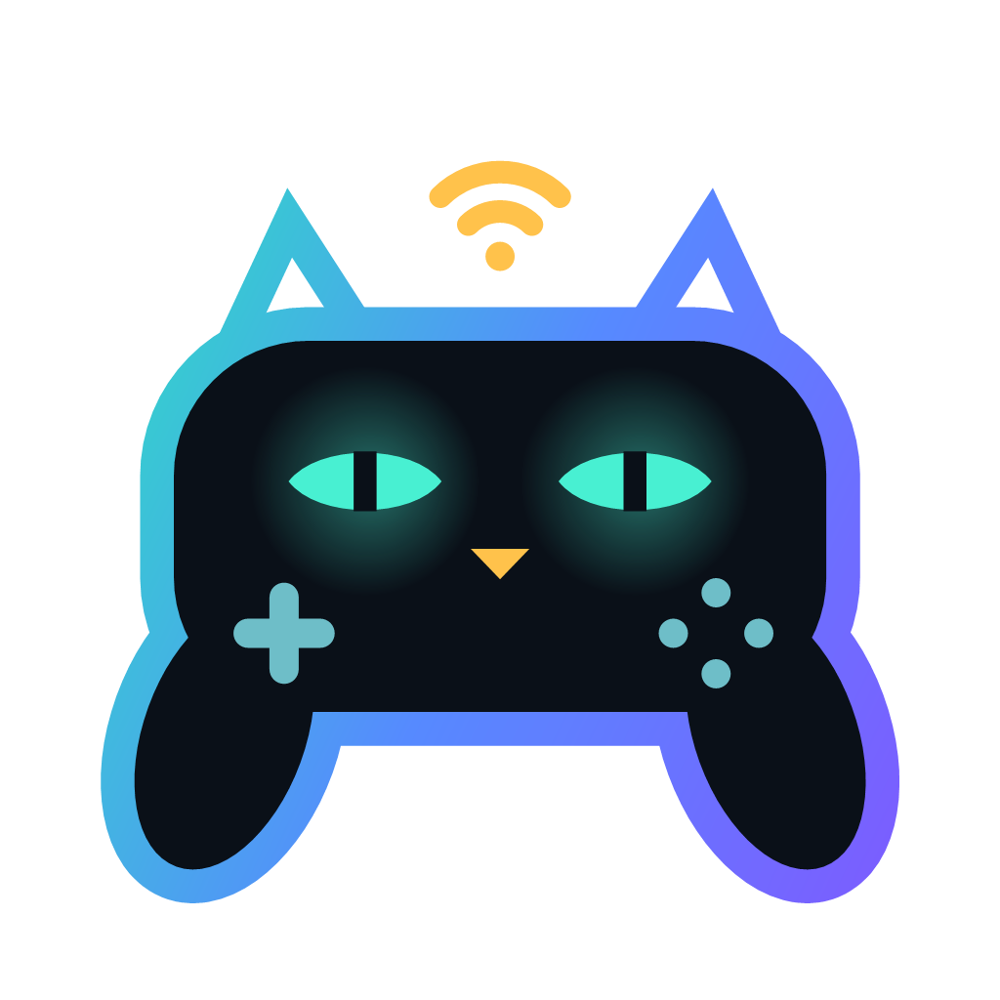

# SKZ Connect

**Connect controllers. Customize inputs. Play.**

SKZ Connect brings Nintendo, PlayStation and other controllers to Windows games and emulators as Xbox or DualShock 4 controllers. An Android app and a Kodi/LibreELEC add-on are also available for Switch 2 controllers.

[Deutsch](README.md) · [English](README.en.md) · [Website](https://devcatskz.github.io/SKZ-Connect/)

## Download

| Platform | Version | Download |
|---|---|---|
| Windows 10 (2004+) / 11, x64 | 1.0.26 | [Setup / Portable](https://github.com/DevCatSKZ/SKZ-Connect/releases/latest) |
| Android 8+, arm64 / x86_64 | 0.9.6 Beta | [APK](https://github.com/DevCatSKZ/SKZ-Connect/releases/download/v1.0.27/SKZ-Connect-Android-0.9.6.apk) |
| Kodi / LibreELEC | 0.4.10 | [DevCatSKZ Repository](https://github.com/DevCatSKZ/kodi-repo) |

## Features

- Up to eight controllers on Windows, with individual or paired Joy-Con.
- Remapping, keyboard and mouse, turbo, macros and per-game profiles.
- Gyro as stick or mouse, flick stick and DSU for emulators.
- 28 model images, an optional buttons-only view and 14 color schemes.
- Android: Switch 2 controllers over Bluetooth LE; virtual output via Shizuku or root, or touch controls.
- Kodi: Switch 2 controllers for Kodi and RetroArch; battery display, model images and skin widgets. Packages for x86_64, ARM64 and ARM.

## Controllers and requirements

Windows supports Switch 1/2 and NSO, Wii/Wii U, DualShock 4 and DualSense, plus selected wired pads. Xbox controllers use native Windows support; SKZ Connect adds display and remapping. Device support differs by platform: [controllers and setup](docs/guide/windows.md).

SKZ Connect on Android supports Switch 2 controllers only. The operating system may support other gamepads directly. On LibreELEC, Linux handles input from additional paired third-party controllers.

The Windows setup installs ViGEmBus and HidHide. App and setup are not code-signed; Windows may display a SmartScreen warning on first launch. Windows is the main platform; Android is in beta. Not all controllers and devices have been tested with real hardware. The new Android/Kodi views have undergone build and automated checks so far.

## Documentation and privacy

[Windows](docs/guide/windows.md) · [Android](docs/guide/android.md) · [Kodi](docs/guide/kodi.md) · [Troubleshooting](docs/guide/troubleshooting.md) · [Technical documentation](docs/README.md) · [Build and test](docs/BUILDING.md)

No account, ads or telemetry. Controllers work offline; the Windows app can check GitHub for updates. Report bugs as an [issue](https://github.com/DevCatSKZ/SKZ-Connect/issues). Review diagnostics for personal information before sharing them.

## License

[MIT](LICENSE), © 2026 devcatskz. [Third-party notices](THIRD-PARTY-NOTICES.md).

Unofficial project, not affiliated with Nintendo, Sony or Microsoft. Trademarks belong to their respective owners.
