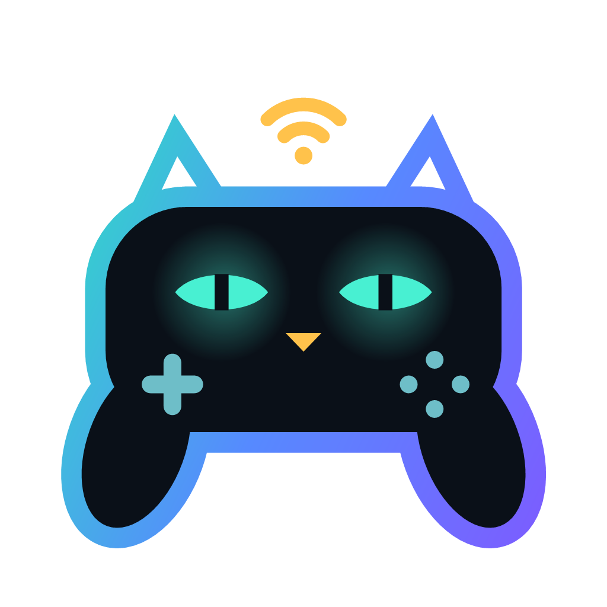

# SKZ Connect

**Controller verbinden. Belegung anpassen. Spielen.**

SKZ Connect bringt Nintendo-, PlayStation- und weitere Controller als Xbox- oder DualShock-4-Controller in Windows-Spiele und Emulatoren. Für Switch-2-Controller gibt es zusätzlich eine Android-App und ein Kodi-/LibreELEC-Add-on.

[Deutsch](README.md) · [English](README.en.md) · [Website](https://devcatskz.github.io/SKZ-Connect/)

## Download

| Plattform | Version | Download |
|---|---|---|
| Windows 10 (2004+) / 11, x64 | 1.0.26 | [Setup / Portable](https://github.com/DevCatSKZ/SKZ-Connect/releases/latest) |
| Android 8+, arm64 / x86_64 | 0.9.5 Beta | [APK](https://github.com/DevCatSKZ/SKZ-Connect/releases/download/v1.0.26/SKZ-Connect-Android-0.9.5.apk) |
| Kodi / LibreELEC | 0.4.10 | [DevCatSKZ Repository](https://github.com/DevCatSKZ/kodi-repo) |

## Funktionen

- Bis zu acht Controller unter Windows, Joy-Con einzeln oder als Paar.
- Tastenbelegung, Tastatur und Maus, Turbo, Makros und Profile je Spiel.
- Gyro als Stick oder Maus, Flick-Stick und DSU für Emulatoren.
- 28 Modellbilder, umschaltbare reine Tastenansicht und 14 Farbschemata.
- Android: Switch-2-Controller über Bluetooth LE; virtuelle Ausgabe per Shizuku oder Root, alternativ Touch-Steuerung.
- Kodi: Switch-2-Controller für Kodi und RetroArch; Akkuanzeige, Modellbilder und Skin-Widgets. Pakete für x86_64, ARM64 und ARM.

## Controller und Voraussetzungen

Windows unterstützt Switch 1/2 und NSO, Wii/Wii U, DualShock 4 und DualSense sowie ausgewählte Kabel-Pads. Xbox-Controller nutzen die native Windows-Unterstützung; SKZ Connect ergänzt Anzeige und Belegung. Der Geräteumfang unterscheidet sich je Plattform: [Controller und Einrichtung](docs/anleitung/windows.md).

Android unterstützt in SKZ Connect ausschließlich Switch-2-Controller. Andere Gamepads können direkt vom Betriebssystem unterstützt werden. Auf LibreELEC übernimmt Linux die Eingaben zusätzlich gekoppelter Fremdcontroller.

Das Windows-Setup installiert ViGEmBus und HidHide. App und Setup sind nicht code-signiert; Windows kann beim ersten Start eine SmartScreen-Warnung anzeigen. Windows ist die Hauptplattform, Android eine Beta. Nicht alle Controller und Geräte sind mit echter Hardware geprüft. Die neuen Android-/Kodi-Ansichten wurden bislang beim Build und automatisiert geprüft.

## Dokumentation und Datenschutz

[Windows](docs/anleitung/windows.md) · [Android](docs/anleitung/android.md) · [Kodi](docs/anleitung/kodi.md) · [Problemlösung](docs/anleitung/hilfe.md) · [Entwicklerdokumentation](docs/README.md) · [Bauen und testen](docs/BUILDING.md)

Kein Konto, keine Werbung, keine Telemetrie. Controllerbetrieb funktioniert offline; die Windows-App kann GitHub auf Updates prüfen. Fehler bitte als [Issue](https://github.com/DevCatSKZ/SKZ-Connect/issues) melden. Diagnoseberichte vor dem Teilen auf persönliche Angaben prüfen.

## Lizenz

[MIT](LICENSE), © 2026 devcatskz. [Komponenten Dritter](THIRD-PARTY-NOTICES.md).

Inoffizielles Projekt ohne Verbindung zu Nintendo, Sony oder Microsoft. Marken gehören ihren jeweiligen Inhabern.
